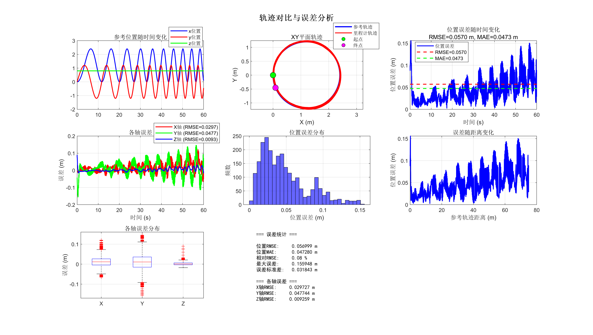

# OMMPC-Controller

<!-- TOC -->

- [OMMPC-Controller](#ommpc-controller)
    - [Usage](#usage)
        - [Prerequisites](#prerequisites)
            - [Ubuntu and ROS](#ubuntu-and-ros)
            - [MAVROS](#mavros)
            - [Dynamic reconfigure](#dynamic-reconfigure)
            - [PX4-Gazebo Simulation](#px4-gazebo-simulation)
            - [OSQP](#osqp)
        - [Cloning the code and compiling](#cloning-the-code-and-compiling)
        - [Run the code](#run-the-code)
    - [Theory and parameters](#theory-and-parameters)
        - [Reading text trajectories](#reading-text-trajectories)
        - [Theory and parameters](#theory-and-parameters)
        - [Thrust Normalization](#thrust-normalization)
    - [Acknowledgment](#acknowledgment)

<!-- /TOC -->

_The TOC is automatically generated by [Auto Markdown TOC](https://marketplace.visualstudio.com/items?itemName=huntertran.auto-markdown-toc)._

If you feel my work has been helpful, please give it a star—thank you!

Also, the control performance is not yet optimal, so if anyone is interested in helping with debugging and parameter tuning, I would be greatly appreciated!

**TODO: add parameters of rotor drag**

Simulation with Gazebo and EGO-Planner-V2:


Error analysis of realworld experiment with a Fast-Drone-250 quadrotor:



## Usage

### Prerequisites

#### Ubuntu and ROS

The package has been tested on Ubuntu 20.04 and ROS noetic. The **default** Eigen is enough for this package to work normally.

#### MAVROS

Follow the guide in https://docs.px4.io/main/en/ros/mavros_installation#install-mavros.

#### Dynamic reconfigure

```bash
sudo apt install ros-noetic-ddynamic-reconfigure
```

#### PX4-Gazebo Simulation

First, clone the source code of PX4-Autopilot:
```bash
git clone https://github.com/PX4/PX4-Autopilot.git --recursive
```
If the clone process completes without any errors, proceed directly to the next step. Otherwise, you can consider the following command:

```bash
cd PX4-Autopilot/
git submodule update --init --recursive
```

Then run the following script to setup:
```bash
bash Tools/setup/ubuntu.sh
```

Reboot, and
```bash
cd PX4-Autopilot/
make px4_sitl_default gazebo
```

You may need to wait a few seconds for gazebo to initialize. After initialization, type `commander takeoff` to make the drone take off, or type `commander land` to make it land.

To increase the frequency of odometry, you can modify the following code in `~/PX4-Autopilot/src/modules/mavlink/mavlink_main.cpp`:
```C++
configure_stream_local("LOCAL_POSITION_NED", 125.0f);  // originally 30.0f
configure_stream_local("ODOMETRY", 125.0f);  // originally 30.0f
```
and `make px4_sitl_default gazebo` again.

Add environment variables to the `.bashrc` file:
```bash
# >>> PX4 initialize >>>
source ~/PX4-Autopilot/Tools/simulation/gazebo-classic/setup_gazebo.bash ~/PX4-Autopilot ~/PX4-Autopilot/build/px4_sitl_default
export ROS_PACKAGE_PATH=$ROS_PACKAGE_PATH:~/PX4-Autopilot
export ROS_PACKAGE_PATH=$ROS_PACKAGE_PATH:~/PX4-Autopilot/Tools/simulation/gazebo-classic/sitl_gazebo-classic
# <<< PX4 initialize <<<
```

#### OSQP

The version of cmake on Ubuntu 20.04 is a bit old and cannot compile the latest version. Therefore, it is necessary to revert to a slightly older version.

```bash
git clone --recursive -b release-0.6.3 https://github.com/osqp/osqp.git
```

If the clone process completes without any errors, proceed directly to the next step. Otherwise, you can consider the following command:

```bash
cd osqp
git submodule update --init --recursive
```

Then, create a build directory:

```bash
cd osqp
mkdir build
cd build
```

Next, create the Makefiles and compile:
```bash
cmake -G "Unix Makefiles" ..
cmake --build .
```

Finally,
```bash
cmake --build . --target install
```
(May require administrator privileges)

Ensure that `libosqp.so` is present, then update the dynamic link library cache using the `ldconfig` command.

### Cloning the code and compiling

```bash
sudo apt install ros-noetic-ddynamic-reconfigure
cd catkin_ws/src
git clone https://github.com/OliverWu515/ommpc_controller.git
cd ..
catkin_make
```

### Run the code

```bash
source devel/setup.bash
roslaunch px4 mavros_posix_sitl.launch
roslaunch ommpc_controller px4_example.launch
```

Takeoff: First, type the following command in the terminal:
```
rosservice call /mavros/set_mode 0 "OFFBOARD"
```

Then, check the `takeoff_enabled` box in the rqt_reconfigure window. The drone will automatically arm and take off.

Command: Check the `command_or_hover` box in the rqt_reconfigure window. The drone will then execute the text trajectory or polynomial trajectory.

Landing: Check the `land_enabled` box in the rqt_reconfigure window. The drone will automatically land and attempt to disarm. If disarming is successful, you can type the following command in the terminal:
```
rosservice call /mavros/set_mode 0 "MANUAL"
```
to return to manual control mode, or you can proceed directly to execute other commands.

**Important:**

The pose of Odometry is defined as forward x, left y, upward z (ENU). The nose of the aircraft points in the positive x-axis direction, and the throttle thrust direction is along the positive z-axis. They must be strictly aligned. If the coordinate frame is NED instead of ENU, the `enu_frame_` parameter in the `OMMPC_EXAMPLE` class must be set to `false`! 

The definition of velocity in Odometry differs from the [ROS official documentation](http://docs.ros.org/en/noetic/api/nav_msgs/html/msg/Odometry.html). The ROS official definition expresses velocity in the body frame, but most open-source odometry systems define velocity relative to the world frame. This controller also defaults to defining velocity in the world frame. If the velocity you are using is defined in the body frame, set `vel_in_body_` to true in the `init` method of the `OMMPC_EXAMPLE` class (**for example, when using Gazebo for simulation**). Otherwise, set it to false (**for example, when using open-source odometry for realworld experiments**).

## Theory and parameters

### Reading text trajectories

If reading text trajectories for testing is enabled, after entering command control mode, the file stored at the path `ref_txt/ref_filename` will be read line by line with a fixed step size `ref_txt/time_step`. The format of each line is:
```
x-position y-position z-position x-velocity y-velocity z-velocity yaw yaw-rate
```
In the `traj` folder, several scripts are stored for generating text trajectories as needed.  
Empty lines are ignored; malformed or non-finite rows disable text trajectory execution. Text samples are reconstructed as a smooth C3 trajectory using position and velocity data, so acceleration and jerk feedforward remain consistent with the sampled motion.

**Related parameters**:  
ref_txt:   
&emsp; enable: Allows the use of text trajectories. If set to `false`, commands from the planner are received instead.  
&emsp; time_step: The sampling step size for the text trajectory. This must match the sampling step used by the trajectory generation script. Playback is based on elapsed ROS time and interpolated at `MPC_params/step_T`, which also sets the control timer period.
&emsp; ref_filename: The path to the text trajectory file, specified as a **relative path** relative to this project.

### Theory and parameters

For the derivation with respect to the dynamic of quadrotors, refer to the file `OMMPC_derivation.pdf` in this repo.

For more general conclusions, refer to [G. Lu, W. Xu and F. Zhang, "On-Manifold Model Predictive Control for Trajectory Tracking on Robotic Systems," in IEEE Transactions on Industrial Electronics, vol. 70, no. 9, pp. 9192-9202, Sept. 2023](https://ieeexplore.ieee.org/abstract/document/9917382).

There are three ways to set the reference trajectory and control inputs:
- Set a hover reference. Related function: `setHoverReference`. This essentially sets the reference pose for the next several steps to the current pose and the velocity to 0.
- Set the reference from a text trajectory. Related functions: `setTextReference`, `get_txt_des`. This function will also be used while setting references during takeoff and landing.
- Set the reference from a polynomial trajectory. Related functions: `setTrajectoryReference`, `feed_from_traj_utils`. If it is necessary to read polynomial trajectories in other formats, you can implement them yourself.

We adopt Hopf fibration to calculate the full state from the flat outputs.

**Related parameters**:  
use_fix_yaw: Whether to fix the yaw angle   
use_trajectory_ending_pos: Whether to ensure reaching the trajectory endpoint, generally set to `true`  
MPC_params:  
&emsp; step_T: MPC step size. When using text trajectories, note that the text trajectory step size must be consistent with this.  
&emsp; Q_pos_xy, Q_pos_z: Weight for horizontal and vertical error, respectively. Should be set 1-3 orders of magnitude larger than other weights.  
&emsp; Q_attitude_rp, Q_attitude_yaw: Attitude error weight.  
&emsp; Q_velocity: Velocity error weight.  
&emsp; R_thrust: Thrust input penalty.  
&emsp; R_pitchroll, R_yaw: Angular velocity input penalty. These penalties should be relatively smaller, otherwise they affect control accuracy; but cannot be too small, otherwise the smoothness will be affected.  
&emsp; state_cost_exponential, input_cost_exponential: State/input error weight discount factor. The weight at step k is multiplied by exp{-k/total_steps * discount_factor}.  
&emsp; max_bodyrate_xy, max_bodyrate_z: Maximum angular rate. It is recommended to set the z-component relatively smaller.  
&emsp; min_thrust/max_thrust: Minimum/Maximum thrust (actually acceleration, unit: m/s^2)


### Thrust Normalization

Assume that

$$
t_{cmd}=\frac{a_{z,d}}{T_a}
$$

where $T_a$ is the normalization constant, which is determined by the physical characteristics of the quadrotor, and can be estimated by Kalman filtering

$$
\begin{aligned}
x_k&=T_{a,k} \\
z_k&=a_z=t_{cmd}\ T_{a,k}
\end{aligned}
$$

Then

$$
\begin{aligned}
\breve{P}_k&=1/\rho \\
K_k&=\frac{\breve{P}_k\cdot t_{cmd}}{t_{cmd} \breve{P}_k\cdot t_{cmd}+\rho} \\
\hat{T}_{a,k}&=\breve{T}_{a,k}+K_k(a_{z,imu}-t_{cmd} \breve{T}_{a,k}) \\
P_k&=(1-K_k\cdot t_{cmd})\cdot \breve{P}_k \\
\end{aligned}
$$

**Related parameters**  
hover_percentage: Used to set the initial value of Ta 


## Acknowledgment

- [Huizhe Li](https://github.com/haiyu1020) and [Yuhao Fang](https://github.com/fweiI/) for instruction of parameter tuning and basic structures of code
- [Autotrans](https://github.com/HKUST-Aerial-Robotics/AutoTrans/tree/main/) and [RPG MPC](https://github.com/uzh-rpg/rpg_mpc) for providing examples of setting reference for MPC
- [SUPER](https://github.com/hku-mars/Super) for providing supporting material including derivation of OMMPC
- [GCOPTER](https://github.com/ZJU-FAST-Lab/GCOPTER) and [SE(3) Controller](https://github.com/HITSZ-MAS/se3_controller) for providing hints of differential flatness with Hopf fibration
- [Fast-Drone-250](https://github.com/ZJU-FAST-Lab/Fast-Drone-250/) for providing examples of using Finite State Machine (FSM) to manage states of quadrotors

### Applied thrust limits

`MPC_params/min_normalized_thrust` and `max_normalized_thrust` default to 0.04 and 0.9. The QP intersects the acceleration bounds with these normalized command limits using the current thrust model. Optional `MPC_params/min_tracking_thrust` reserves collective thrust during text/polynomial trajectories; it defaults to the ordinary minimum and does not affect hover, takeoff or landing. Thrust estimation records the final command actually published, including its clamp. Increasing trajectory speed still requires checking the vehicle's physical thrust and angular-rate limits; optimizer success alone does not establish tracking feasibility.

### Inverted vertical-loop simulation

The optional `params_flip.yaml` example uses a continuous quaternion lift of the thrust direction. It transports the transverse body axes from the previous **reference** attitude, retains quaternion sign continuity, and computes angular-rate feedforward from acceleration and jerk. It passes through downward thrust directions without a north-chart singularity. This mode requires `use_fix_yaw: true`; its yaw convention is zero spin about the thrust axis, rather than an absolute Euler yaw constraint on arbitrary 3D paths. Legacy examples retain their original yaw convention by default.

Text references can also provide 14 columns: `px py pz vx vy vz yaw yawdot ax ay az jx jy jz`. Acceleration and jerk are used directly in C3 Hermite interpolation. Existing 8-column references remain supported. The generated example joins hover, three constant-speed vertical circles, and a stop using septic polynomial transitions. It uses a 1.2 m radius and about 4.49 m/s speed, with positive thrust directed downwards at the top of each circle.

Stock Gazebo Iris has insufficient thrust for this example. `sim/generate_agile_model.py` creates a separate experimental SDF with motor thrust constants multiplied by 2.4, preserving stock mass/inertia and PX4 assets. This vehicle is an explicit simulation assumption, not a replica of the paper's aircraft. The example keeps the existing 20-step horizon and uses simulation-tuned feedback weights; it does not reproduce all paper parameters. Its calibrated mapping is `acceleration = gain * (normalized_thrust + offset)^power`. Defaults (`power=1`, `offset=0`, online estimation enabled) preserve the original linear model. Quadratic calibration and disabled estimation apply only to this simulation configuration.

With ROS Noetic, Gazebo Classic, PX4 SITL and MAVROS configured in the shell:

```bash
python3 <package>/traj/generate_vertical_flip.py
python3 <package>/sim/generate_agile_model.py --px4 <PX4-Autopilot>
# Use an isolated ROS_HOME for this experiment, since PX4 stores SITL parameters there.
export ROS_HOME=<absolute-test-directory>/ros_home
roslaunch ommpc_controller aggressive_flip_sitl.launch gui:=false
```

In a second terminal with the same ROS master environment, run the test harness (which arms, flies and lands the simulation):

```bash
python3 <package>/test/run_tracking_sitl.py --agile --odometry /flip/ground_truth/odom \
  --trajectory <package>/traj/vertical_flip.traj --output <absolute-test-directory>
python3 <package>/test/analyze_flip.py <absolute-test-directory> \
  --metadata <package>/traj/vertical_flip.json
```

The aggressive launch initializes `EKF2_GPS_DELAY=120` before EKF startup, matching the GPS plugin delay in this Gazebo Classic setup. Override with `ekf_gps_delay_ms:=10` only for comparison; this setting is specific to this simulation chain. Stock launches are unchanged.

The aggressive launch defaults to ideal Gazebo odometry at 100 Hz, comparable to noiseless external motion-capture feedback. It preserves the MAVROS body-velocity convention and is explicitly a simulation-only assumption. To evaluate the full PX4 estimator, launch with `ground_truth_feedback:=false` and omit `--odometry` from the harness. The original examples continue to use MAVROS odometry.

The harness synchronizes PX4 parameters, applies the experimental rate-controller gains before arming, and restores them after disarm. `--agile` must be used only with this experimental vehicle. Analysis records each complete pitch revolution, actual body Z direction at the circle top, position error and solver failures; trajectory completion alone is insufficient to pass the flip check. Raw odometry, IMU, reference quaternions, commands and Gazebo poses are saved for inspection.

### PX4 feedback frequency and synchronization comparison

For the aggressive SITL example, `ground_truth_feedback:=false synchronized_feedback:=true` selects `/ommpc_controller/px4_synced_odom`. This uses position, quaternion and velocity from one PX4 MAVLink `ODOMETRY` packet and keeps MAVROS's synchronized sample timestamp. It does not use Gazebo state, interpolate separate measurements, or extrapolate the state. The adapter targets the installed MAVROS 1.20.x plugin: PX4 emits world NED velocity, while that plugin maps its twist as BODY_FRD. Raw MAVLink frame IDs are checked before correcting velocity to body FLU. Recheck this adapter when upgrading MAVROS; do not substitute the uncorrected `/mavros/odometry/in` twist.

The synchronized adapter additionally requires the Python `numpy` and `pymavlink` modules in the interpreter used by ROS. The generators and offline plots use `numpy` and `matplotlib`.

Use `test/run_tracking_sitl.py --feedback-mode high_rate --feedback-rate 100` to request 100 Hz `LOCAL_POSITION_NED`, `ATTITUDE_QUATERNION` and `ODOMETRY`. For the synchronized launch, use `--feedback-mode synchronized --odometry /ommpc_controller/px4_synced_odom` with the same rate. Other required arguments and `--agile` remain as in the flight test above. These options only change MAVLink streams; achieved frequency must be measured. Start a fresh SITL instance for each comparison: requested stream rates stay active until restart. The default mode remains `baseline`. Unit checks for frame conversion can be run with `python3 <package>/test/px4_odometry_math_test.py`.

### Five-loop vertical helix with roll flips

`traj/generate_vertical_helix.py` generates a trajectory of the same type as paper Fig. 7(a): five vertical circles in the YZ plane, with translation along X and continuous roll inversions. It uses the previously tested 1.2 m radius and 1.68 s circle period, moves 2.4 m along X during the circles, and has C3 entry/exit transitions. It is a constructed simulation reference; the paper does not supply the original reference samples. The entry/exit altitude and vehicle dynamics are specific to this example.

Generate with `python3 <package>/traj/generate_vertical_helix.py`. In a fresh isolated SITL, select it with:

```bash
roslaunch ommpc_controller aggressive_flip_sitl.launch gui:=true \
  ground_truth_feedback:=false synchronized_feedback:=true \
  ref_filename:=/traj/vertical_helix.traj ekf_gps_delay_ms:=120
python3 <package>/test/run_tracking_sitl.py --agile \
  --feedback-mode synchronized --feedback-rate 100 \
  --odometry /ommpc_controller/px4_synced_odom \
  --trajectory <package>/traj/vertical_helix.traj --output <absolute-test-directory>
```

`test/analyze_helix.py` checks each complete roll revolution and downward thrust at each circle top, evaluates truth-based position and SO(3) attitude errors after fixed pre-takeoff frame alignment, and produces a figure showing the same quantities as paper Fig. 7(a). Run with `python3 <package>/test/analyze_helix.py <absolute-test-directory> --metadata <package>/traj/vertical_helix.json`. The current harness records the controller's thrust calibration for plotting commands; older saved runs can supply it in a parent `manifest.json`. The launch defaults still select the existing three-loop pitch reference.

The original `circle_vertical.py` and `var_circle.py` currently contain accelerating stress-test settings, with final speeds of 13 m/s and 10 m/s respectively. Their required centripetal thrust can exceed the test vehicle's envelope; they are separate from the bounded fixed-speed flip/helix examples above. A file-by-file explanation of recent changes and validation is in [the change notes](ommpc_controller/doc/recent_changes_20261014.md).
